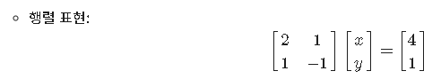
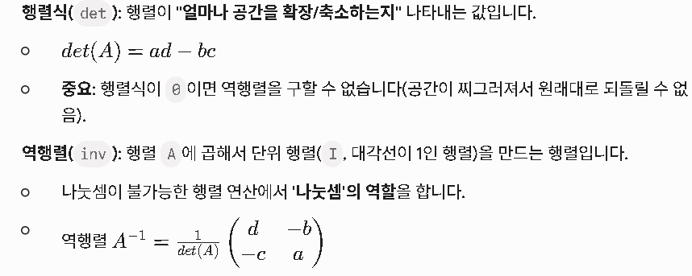

- 데이터 과학의 핵심 라이브러리 생태계(Numpy, Pandas, Matplotlib)를
**큰 그림**에서 이해한다.

- Numpy로 수치 데이터를 **효율적으로** 생성, 조작, 연산할 수 있다.

- 선형대수학의 기초 개념(벡터, 행렬, 연산, 전치/역행렬)을
**넘파이 코드로 구현**할 수 있다.

---

- Numpy: 파이썬에서 **고성능 수치 연산**을 담당하는 **배열 엔진**.
 ML/DL의 전처리와 수치 연산의 기반.

- Pandas
: **표 형식 데이터프레임**으로 정리·가공·집계에 최적. 
 실무 데이터 핸들링의 표준.

- Matplotlib: 분석 결과를 **시각화**하여 패턴을 발견하고 의사결정을 돕는다

[//]: # (heading_4 is not supported)

- 벡터는 여러 숫자를 **순서대로 나열한 것**

- 흔히 화살표(방향과 크기) 또는 좌표처럼 생각할 수 있다.

- 벡터는 "차원(dimension)"의 개수에 따라 구분된다.

- 숫자 1개만 가지는 벡터

- 단순히 **실수축 위의 한 점**

- $ \vec{v} = \begin{bmatrix} 3 \end{bmatrix} $

- --●--------→ x

- 숫자 2개 (x, y)

- 평면 위의 점 혹은 "화살표"

- $ \vec{v} = \begin{bmatrix} 2 \\ 3 \end{bmatrix} $


```yaml
y ↑
  |
3 | ● (2,3)
  |
  |——————→ x
     2
```

- 숫자 3개 (x, y, z)

- 공간(입체) 속의 한 점

- $ \vec{v} = \begin{bmatrix} 1 \\ 2 \\ 3 \end{bmatrix} $

- 좌표 (1,2,3) 은 "x축으로 1, y축으로 2, z축으로 3 이동한 점"을 의미한다.

[//]: # (heading_4 is not supported)

- 덧셈:

$$ \begin{bmatrix} 1 \\ 2 \end{bmatrix} +
\begin{bmatrix} 3 \\ 4 \end{bmatrix} =
\begin{bmatrix} 4 \\ 6 \end{bmatrix} $$

- 스칼라 곱:

$$ 2 \times \begin{bmatrix} 1 \\ 2 \end{bmatrix} =
\begin{bmatrix} 2 \\ 4 \end{bmatrix} $$

### 🐟행렬(Matrix)

- 행렬은 숫자를 **직사각형 모양**으로 배열한 것

- 여러 벡터를 모아 만든 "데이터 표"

$$ A =
\begin{bmatrix}
1 & 2 \\
3 & 4 \\
5 & 6
\end{bmatrix} $$

- 크기: 3행 2열 (3×2 행렬)

[//]: # (heading_4 is not supported)

- **데이터 표**: 행 = 샘플의 수, 열 = 변수(x , y)

- **벡터의 집합**: 여러 벡터(2개 이상)의 모음

- **선형 변환**: 벡터를 입력하면, 특정 규칙(행렬 곱)에 따라 새로운 벡터로 바꿔주는 과정
→ 마치 벡터를 "회전, 확대/축소, 반사"시키는 것처럼 생각할 수 있다.

[//]: # (heading_4 is not supported)

1. **덧셈/뺄셈**

	- 같은 크기의 행렬끼리만 가능

	$$ \begin{bmatrix} 1 & 2 \\ 3 & 4 \end{bmatrix} +
\begin{bmatrix} 5 & 6 \\ 7 & 8 \end{bmatrix} =
\begin{bmatrix} 6 & 8 \\ 10 & 12 \end{bmatrix} $$

1. **스칼라 곱**

	- 모든 원소에 같은 수 곱하기

	$$ 2 \times \begin{bmatrix} 1 & 2 \\ 3 & 4 \end{bmatrix} =
\begin{bmatrix} 2 & 4 \\ 6 & 8 \end{bmatrix} $$

1. **행렬 곱**

	- "앞 행렬의 행 × 뒤 행렬의 열"

	- (m×n) × (n×p) = (m×p)

	$$ \begin{bmatrix} 1 & 2 \\ 3 & 4 \end{bmatrix}
\times
\begin{bmatrix} 5 \\ 6 \end{bmatrix}
=
\begin{bmatrix} 17 \\ 39 \end{bmatrix} $$


```smalltalk
✳첫 번째 행의 결과값 (17)
:(1 x 5) + (2 x 6) = 5 + 12 = 17

두 번째 행의 결과값 (39)
:(3 x 5) + (4 x 6) = 15 + 24 = 39
```

[//]: # (heading_4 is not supported)

- **전치행렬 (Transpose)**: 행과 열을 뒤바꾼 행렬

	$$ \begin{bmatrix} 1 & 2 & 3 \\ 4 & 5 & 6 \end{bmatrix}^T =
\begin{bmatrix} 1 & 4 \\ 2 & 5 \\ 3 & 6 \end{bmatrix} $$

- **단위행렬 (Identity)**: 대각선이 1, 나머지는 0
아무것도 안한 원래 상태

	$$ I = \begin{bmatrix} 1 & 0 \\ 0 & 1 \end{bmatrix} $$

- **역행렬 (Inverse)**: A와 곱했을 때 단위행렬이 되는 행렬
그연산을 취소하는 연산자

	$$ A \times A^{-1} = I $$


```smalltalk
✳ 역행렬은 원상복구 시켜주는 열쇠
우리가 어떤 데이터를 행렬 A로 곱해서 변형 
:데이터를 2배로 늘리거나, 오른쪽으로 45도 회전시키기

◾행렬 $A$: 데이터를 변형시키는 '마법사
◾역행렬 $A^{-1}$: 변형된 데이터를 다시 원래대로 돌려놓는 '해독제'

✳$A$라는 마법을 부린 뒤에 다시 $A^{-1}$이라는 해독제를 먹이면,
 데이터는 처음에 가졌던 본래의 모습($I$, 단위행렬)으로 돌아옴
>>(입력 데이터) $\times$ (행렬 $A$) = (결과 데이터)
>>추적 과정: (결과 데이터) $\times$ (역행렬 $A^{-1}$) = (원래의 입력 데이터)
즉, 역행렬이 없다면 거꾸로 추적이 불가! 
그래서 역행렬은 데이터의 원인을 찾아내는 중요한 도구

✳숫자 5가 있습니다. 여기에 2를 곱하면 10
 다시 원래 숫자 5로 돌아가려면 어떻게 하나요?
 2를 곱하는 대신 2로 나누기(x1/2)
 행렬의 세계에서 '2'가 행렬 $A$라면,
 '1/2'이 바로 역행렬 $A^{-1}$
```

### 🐟선형시스템 (Ax = b)

- 연립방정식을 행렬과 벡터로 표현할 수 있다.

	- 예:

$$ 2x + y = 4 \\
x - y = 1 $$



- **벡터**는 숫자의 나열이며, 1D/2D/3D로 구분된다.

- **행렬**은 여러 벡터를 모아둔 2차원 구조다.

- 행렬 곱은 "행 × 열" 규칙으로 계산한다.

- 전치, 단위, 역행렬은 행렬의 기본 개념이다.

- 연립방정식은 \(Ax = b\) 로 표현할 수 있다.

---

[//]: # (heading_4 is not supported)

- Numeric + Python의 약자, 수학 및 과학 연산 라이브러리

- 배열이나 행렬계산에 필요한 함수 제공

- 수열 데이터를 다룰 때 용이

- 다차원 배열(Array)를 다룰 때 사용!
(인공신경망,비정형데이터,자연어처리 등)

[//]: # (heading_4 is not supported)

1. 빠른 배열 연산

	- 파이썬의 기본 리스트보다 빠른 속도로 벡터와 행렬 연산을 수행

	- 내부적으로 C 언어로 구현, 반복문을 직접 작성하지 않아도 됨.

1. 다양한 수학 함수 제공

	- 합계, 평균, 표준편차 같은 기본 통계부터, 
선형대수(행렬 곱, 역행렬 등), 푸리에 변환까지 지원

	
```smalltalk
음악(파동)은 드럼+기타+피아노 소리가 뒤섞여있는 복잡한 신호!
시간의 흐름에 따른 신호(Time Domain)만 보면 
이게 어떤 악기들이 섞여서 만들어진 소리인지 알기 어려움
이때,푸리에 변환을 사용하면 "이 음악에는 440Hz 소리가 
얼마큼, 520Hz 소리가 얼마큼 섞여 있구나!" 
하고 각각의 주파수 성분(Frequency Domain)으로 분해가능

즉,스무디를 다시 과일과 우유로 분리하는 것과 비슷함!
-------------------------------------------------------
✳노이즈 제거 (Filter)
: 센서 데이터에서 기계적인 떨림(노이즈)은 특정 주파수를
  가집니다. 푸리에 변환으로 해당 주파수만 딱 골라내서
  제거하면 깨끗한 신호만 남길 수 있습니다.

✳패턴 찾기
: 주식 시장이나 날씨 데이터처럼 복잡하게 변하는 데이터 속에
 숨겨진 주기적인 패턴(계절성, 순환성)을 찾아낼 때 유용합니다.

✳데이터 압축
: MP3나 JPEG 같은 파일 형식도 사실
 푸리에 변환(혹은 그 변형)을 사용하여, 사람이 잘 느끼지
 못하는 주파수 성분을 제거함으로써 용량을
 획기적으로 줄이는 원리를 사용합니다.
```

1. 브로드캐스팅(Broadcasting)

	- 크기가 다른 배열끼리도 규칙에 따라 자동으로 맞춰 연산 가능

	- 예: 행렬 전체에 상수 더하기, 벡터를 행렬 각 행에 더하기.

	
```smalltalk
✳예시 1: 행렬에 상수 더하기 (1xN)
행렬 A (3x3)에 숫자 5를 더할 때:
5를 3x3 크기의 행렬 [[5,5,5], [5,5,5], [5,5,5]]로 
알아서 확장해서 계산합니다.

✳예시 2: 행렬 각 행에 벡터 더하기
3x3 행렬에 1x3 벡터를 더할 때:
1x3 벡터를 3x3으로 세로로 복사해서 크기를 맞춘 뒤 연산합니다.

✳브로드캐스팅의 핵심 규칙
◾Numpy는 두 배열의 뒤쪽 차원(가장 오른쪽)부터 크기를 비교
◾두 차원의 크기가 같다.
◾둘 중 하나의 차원이 1이다.
->(1인 쪽을 큰 배열에 맞춰 복사해서 늘립니다.)
```

	
```python
import numpy as np

# A: (3, 3) 행렬
A = np.array([[1, 1, 1], [2, 2, 2], [3, 3, 3]])
# B: (1, 3) 행렬 (벡터)
B = np.array([1, 2, 3])

# 결과는? A의 각 행에 B가 더해짐
# [[1+1, 1+2, 1+3],
#  [2+1, 2+2, 2+3],
#  [3+1, 3+2, 3+3]]
print(A + B)
```

1. 머신러닝/딥러닝의 기반

	- 텐서플로우(TensorFlow), 파이토치(PyTorch) 같은 
딥러닝 프레임워크도 내부 연산을 Numpy와 유사한 구조로 수행

	- 즉, Numpy 배열을 자유자재로 다룰 수 있어야
 ML/DL의 연산 원리를 이해 가능!


```smalltalk
✳ Numpy 모듈 불러오기 
import numpy as np 
```

---


```python
data = np.array([1,2,3,4,5,6])
data#array([1,2,3,4,5,6])
print(type(data))#<class 'numpy.ndarray'>
```


```python
#배열의 차원
data.shpae #(6,) : ,찍힌이유는 튜플이라서그렇다
type(data.shape) #tuple
display(data.shape) #(6,)
```


```python
#배열 원소의 데이터 타입
data.dtype #dtype('int64')
```


```python
# 배열인덱스 2의 원소 
data[2] #np.int64(3)
```

---

[//]: # (heading_4 is not supported)


```python
import numpy as np

data1 = [0,1,2,3,4,5]
a1 = np.array(data)
a1 #array([0, 1, 2, 3, 4, 5])
```


```python
print(type(data1))#<class 'list'>
print(type(a1))#<class 'numpy.ndarray'>
```


```python
data2 = [0.1, 5, 4, 12, 0.5]
a2 = np.array(data2)
a2 #array([ 0.1,  5. ,  4. , 12. ,  0.5])
```


```python
a1.dtype #dtype('int64')
a2.dtype #dtype('float64')
```


```python
np.array([0.5, 2, 0.01, 8])
#array([0.5 , 2.  , 0.01, 8.  ])
```


```python
np.array([[1,2,3], [4,5,6], [7,8,9]])
"""
array([[1, 2, 3],
       [4, 5, 6],
       [7, 8, 9]])
"""
```


```python
test_mat = np.array([[1,2,3], [4,5,6], [7,8,9], [1,1,1]])
print(test_mat)
"""
 [[1 2 3]
 [4 5 6]
 [7 8 9]
 [1 1 1]]
"""
display(test_mat.shape) #(4, 3)
```


```python
"""
arr_obj = np.arange(start, stop, step)
→ start부터 시작해서 stop 전까지 step만큼 계속 더해 배열 생성
"""
# np.arange(1, 10, 1) 반환값 동일함
np.arange(1,10) #array([1, 2, 3, 4, 5, 6, 7, 8, 9])
# np.arange(0, 5, 1)
np.arange(5)#array([0, 1, 2, 3, 4])
```


```python
#짝수반환
np.arange(2, 15, 2) #array([ 2,  4,  6,  8, 10, 12, 14])
#홀수반환
np.arange(1,15,2) #array([ 1,  3,  5,  7,  9, 11, 13])
```


```python
np.arange(12)
#array([ 0,  1,  2,  3,  4,  5,  6,  7,  8,  9, 10, 11])

# 1차원 배열을 reshape()을 이용해 2차원 배열로 변경
np.arange(12),reshape(4,3)
"""
array([[ 0,  1,  2],
       [ 3,  4,  5],
       [ 6,  7,  8],
       [ 9, 10, 11]])
"""
```


```python
b1 = np.arange(12).reshape(4,-1)
b1
"""
array([[ 0,  1,  2],
       [ 3,  4,  5],
       [ 6,  7,  8],
       [ 9, 10, 11]])
"""
# .reshape(4, -1)
# 4(행), -1(전체개수12개 맞추기위해 컴퓨터가 직접계산)
```


```python
import numpy as np

# 데이터가 5개인 경우
data = np.arange(5) # [0, 1, 2, 3, 4]

# 오류 발생! (ValueError: cannot reshape array of size 5 into shape (4, newaxis))
data.reshape(4, -1)
"""
행렬은 가로와 세로가 딱 맞아떨어지는 직사각형(또는 정사각형) 구조!
"""

```


```python
# b1을 다시 1차원 배열로 만든다
b1.reshape(-1)
#array([ 0,  1,  2,  3,  4,  5,  6,  7,  8,  9, 10, 11])
```


```python
# b를 3차원 배열로 만들어보세요
b1.arange(100).reshape(2,5,10)
"""
array([[[ 0,  1,  2,  3,  4,  5,  6,  7,  8,  9],
        [10, 11, 12, 13, 14, 15, 16, 17, 18, 19],
        [20, 21, 22, 23, 24, 25, 26, 27, 28, 29],
        [30, 31, 32, 33, 34, 35, 36, 37, 38, 39],
        [40, 41, 42, 43, 44, 45, 46, 47, 48, 49]],

       [[50, 51, 52, 53, 54, 55, 56, 57, 58, 59],
        [60, 61, 62, 63, 64, 65, 66, 67, 68, 69],
        [70, 71, 72, 73, 74, 75, 76, 77, 78, 79],
        [80, 81, 82, 83, 84, 85, 86, 87, 88, 89],
        [90, 91, 92, 93, 94, 95, 96, 97, 98, 99]]])
"""
```


```smalltalk
✳차원의 계층 구조 (그릇의 비유)

◾0차원 (스칼라, Scalar): 그냥 점 하나입니다. (예: 5)

◾1차원 (벡터, Vector): 숫자를 일렬로 세운 선입니다.
                      (예: [0, 1, 2, 3])
데이터 사이언스에서는 하나의 샘플(Sample)을 나타내는 정보들입니다.

◾2차원 (행렬, Matrix): 선들을 차곡차곡 쌓은 면(표)입니다.
                     (예: Excel 시트)(행, 열)로 구성됩니다.
                     위의 reshape(4, -1)이 바로 2차원!
                     
◾3차원 (텐서, Tensor/3D Array)
: 면들을 여러 겹 쌓은 입체(상자)입니다.
  (깊이, 행, 열)로 구성됩니다.
  방금 만드신 reshape(2, 5, 10)이 바로 이것입니다
```


```smalltalk
✳3차원 이상의 배열에서 우리가 알고 있는 정보
(예: 깊이와 열)를 양 끝에 두고, 
가운데 차원을 -1로 비워두면, 
Numpy가 전체 개수를 고려해서 자동으로 중간 크기를 결정

데이터가 총 100개이고, 
(깊이 2, 중간 ?, 열 10) 형태로 만들고 싶다면:reshape(2, -1, 10)
컴퓨터 계산: 2 x 10 = 20 
전체는 100개이므로, 100 / 20 = 5
>>자동으로 (2, 5, 10) 배열이 생성
  ---------------------------------------------
◾배치(Batch) 크기 자동화
: reshape(-1, 5, 10) 
 (전체 데이터가 몇 개든 상관없이 5x10 형태로 다 쌓아라)

◾특성(Feature) 개수 자동화
: reshape(2, 5, -1) 
  (구조는 정해져 있으니, 나머지 정보를 다 열로 합쳐라)
  ---------------------------------------------
맨 앞: reshape(-1, 5, 10) ->"개수(Batch)는 알아서 해!"
중간: reshape(2, -1, 10) ->"가운데 차원(Sequence나 행)은 알아서 해!"
맨 뒤: reshape(2, 5, -1)-> "마지막 차원(Feature나 열)은 알아서 해!"
```


```python
np.linspace(1, 10, 10)
#array([ 1.,  2.,  3.,  4.,  5.,  6.,  7.,  8.,  9., 10.])
```


```smalltalk
✳np.linspace(시작, 끝, 개수)
:"1부터 10까지를 10등분 해서 구간을 채워줘!
 "내가 원하는 시작과 끝 지점을 정해두고, 
     그 사이를 내가 원하는 만큼 등분해서 채워 넣는 도구"

⚠ arange와 다른점!
np.arange(1, 11)
: "1부터 간격(step)을 1씩 더해서 10까지 만들어줘" (간격 중심)
np.linspace(1, 10, 10)
:"1부터 10까지를 10개의 점으로 나눠줘" (개수 중심)
```


```python
np.linspace(0, np.pi, 20 )
#np.sin() 함수를 씌우면,
# 0도부터 180도까지의 사인 곡선을 그리기 위한 20개의 좌표만듬
"""
array([0.        , 0.16534698, 0.33069396, 0.49604095, 0.66138793,
       0.82673491, 0.99208189, 1.15742887, 1.32277585, 1.48812284,
       1.65346982, 1.8188168 , 1.98416378, 2.14951076, 2.31485774,
       2.48020473, 2.64555171, 2.81089869, 2.97624567, 3.14159265])
"""
```


```python
np.zeros(10)
#array([0., 0., 0., 0., 0., 0., 0., 0., 0., 0.])
np.zeros((3,4))
"""
array([[0., 0., 0., 0.],
       [0., 0., 0., 0.],
       [0., 0., 0., 0.]])
"""
```


```smalltalk
0으로 채우기 (np.zeros) :의도적설정
기능: 모든 원소를 0으로 초기화한 배열 생성.

사용: 데이터 분석 전 초기값 설정이나, 결과값 저장 공간 확보 시 사용.

np.zeros(10) : 1차원 배열(10개)

np.zeros((3, 4)) : 3행 4열 2차원 배열
```


```python
np.ones(5) #array([1., 1., 1., 1., 1.])
np.ones((3,5))
"""
array([[1., 1., 1., 1., 1.],
       [1., 1., 1., 1., 1.],
       [1., 1., 1., 1., 1.]])
"""
```


```smalltalk
1로 채우기 (np.ones) :의도적 설정
기능: 모든 원소를 1로 초기화한 배열 생성.

사용: 가중치 초기화나 마스킹 연산 시 주로 사용.

np.ones(5) : 1차원 배열(5개)

np.ones((3, 5)) : 3행 5열 2차원 배열
```


```python
np.eye(5)
"""
array([[1., 0., 0., 0., 0.],
       [0., 1., 0., 0., 0.],
       [0., 0., 1., 0., 0.],
       [0., 0., 0., 1., 0.],
       [0., 0., 0., 0., 1.]])
"""
```


```smalltalk
단위행렬 생성 (np.eye)
기능: 대각선 원소는 1, 나머지는 0으로 채워진 정사각행렬 생성.

사용: 선형대수 연산, 역행렬 계산의 기준점(단위행렬) 필요 시 사용.

np.eye(5) : 5x5 크기의 단위행렬 생성
```


```smalltalk
list1 = [1, 2, 3, 4, 5, 6]
list1.mean()
---------------------------------------------------------------------------
AttributeError                            Traceback (most recent call last)
/tmp/ipython-input-1743286142.py in <cell line: 0>()
      1 list1 = [1, 2, 3, 4, 5, 6]
----> 2 list1.mean()

AttributeError: 'list' object has no attribute 'mean'
```


```python
# 리스트 -> array
arr = np.array(list1)
arr.mean() #np.float64(3.5)
```


```python
print(type(list1)) #<class 'list'>
print(type(arr))#<class 'numpy.ndarray'>
```


```python
list_to_arr = arr.tolist()

print(list_to_arr)#[1, 2, 3, 4, 5, 6]
print(type(list_to_arr))#<class 'list'>
```

> list() 메소드도 사용이 가능하긴 하지만, 
다차원 배열에서는 내부 배열이 array 형태로 잔류한다는 점이 다릅니다.


```python
data = np.array([[1, 2, 3], [4, 5, 6]])

# tolist로 변환하면
arr1 = data.tolist()
print(arr1) #[[1, 2, 3], [4, 5, 6]]
print(type(arr1))#<class 'list'>
print(type(arr1[0])) #<class 'list'>

print('\n-------------------------\n')
# list()로 변환하면
arr2 = list(data)#data를 list로 감싸기만 한것이다
print(arr2)#[array([1, 2, 3]), array([4, 5, 6])]
print(type(arr2))#<class 'list'> 겉은 list
print(type(arr2[0]))#<class 'numpy.ndarray'>안은 numpy
```

 | **구분** | **data.tolist()** | **list(data)** | 
 | ---- | ---- | ---- | 
 | **결과 형태** | 완전한 리스트/숫자 데이터 | 리스트 안에 배열(ndarray)이 담김 | 
 | **내부 원소 타입** | `int` (파이썬 기본 타입) | `numpy.ndarray` | 
 | **추천 상황** | 데이터를 순수 리스트로 써야 할 때 | 배열의 '행'만 순회(iterate)하고 싶을 때 | 

- `**list()**`** 함수**는 반복 가능한 객체(Iterable)를 리스트로 만드는 것인데, Numpy 배열은 행(row) 단위로 반복 가능하므로, 각 행(배열)을 리스트의 원소로 집어넣은 것입니다.

- **데이터 타입 유지**: `list()`를 쓰면 데이터 안쪽은 여전히 Numpy 기능
(연산 등)을 사용할 수 있는 `ndarray` 형태가 그대로 남아있다는 점이 중요합니다.

[//]: # (heading_4 is not supported)


```python
# rand(): [0. 1) 사이의 실수 난수를 갖는 넘파이 배열 생성:랜덤설정

np.random.rand(2,3) # 2 x 3의 2차원 배열의 실수 난수 생성

"""
array([[0.65641715, 0.01403694, 0.12389294],
       [0.17753663, 0.63383846, 0.25412915]])
"""
```


```python
np.random.rand() # 사이즈를 입력하지 않으면 1로 간주
#0.7088897681458253
```


```python
# randint(): 지정한 범위에 해당하는 정수로 난수 배열을 생성
np.random.randint(10, size=(3, 4))
"""
0~9까지로 만든 3행4열의 배열
array([[8, 7, 0, 2],
       [2, 7, 9, 1],
       [0, 7, 2, 3]])
"""
```

- NumPy에서 난수(랜덤 숫자)를 생성할 때, “결과의 재현 가능성을 보장”
하기 위해 사용하는 초기값 설정 방법

- 난수 생성은 기본적으로 예측 불가능하지만, 시드를 설정하면 동일한 난수 시퀀스를 반복적으로 얻을 수 있음

- 주로 실험 재현, 디버깅, 테스트 등에서 사용됨


```smalltalk
✳시드 설정 없이 난수 생성
pythonimport numpy as np
print(np.random.rand(3))  
# 매번 다른 난수 출력, 예: [0.123, 0.456, 0.789]
print(np.random.rand(3))  
# 또 다른 난수 출력, 예: [0.321, 0.654, 0.987]

✳시드 설정 후 난수 생성
pythonimport numpy as np
np.random.seed(42)  # 시드값 42 설정
print(np.random.rand(3))  
# 출력: [0.37454012, 0.95071431, 0.73199394]
np.random.seed(42)  # 동일한 시드값 재설정
print(np.random.rand(3))  
# 출력: [0.37454012, 0.95071431, 0.73199394] (동일)
```


```python
import nump as np
np.random.seed(30)
print(np.random.rand(3))  # 출력: [0.37454012, 0.95071431, 0.73199394]

np.random.seed(42)  # 동일한 시드값 재설정
print(np.random.rand(3))  # 출력: [0.37454012, 0.95071431, 0.73199394] (동일)
```

[//]: # (heading_4 is not supported)


```python
np.array(['1.5', '0.62', '2', '3.14', '3.141592'])
#array(['1.5', '0.62', '2', '3.14', '3.141592'], dtype='<U8')

#dtype = '<U8'은 데이터의 형식이 유니코드
#문자의 수는 최대 8개라는 것을 의미
```


```python
"""
str_a9 = np.array(['1.567', '0.123', '5.123', '9', '8'])
str_a9
#array(['1.567', '0.123', '5.123', '9', '8'], dtype='<U5')
>>
dtype='<U5'란?
Numpy 배열의 데이터 타입(Data Type)을 나타냄.
U: Unicode String (문자열)
5: 해당 배열 내 문자열의 최대 글자 수 (가장 긴 데이터 기준)
"""
str_a1 = np.array(['1.567', '0.123', '5.123', '9', '8'])
str_a1.dtype #dtype('<U5')


num_a1 = str_a1.astype(float) # Numpy 배열의 형 변환
num_a1 #array([1.567, 0.123, 5.123, 9.   , 8.   ])
num_a1.dtype #dtype('float64')
```


```python
str_a2 = np.array(['1', '3', '5', '7', '9'])
str_a2.dtype #dtype('<U1')

num_a2 = str_a2.astype(int)
num_a2
num_a2.dtype #dtype('int64')
```


```smalltalk
✳astype(int)와 정보 훼손의 관계
질문하신 대로 int로 변환할 때 
정보 훼손의 가능성이 있다는 것은 아주 중요한 통찰입니다.

◾왜 훼손되나요?
:만약 str_a2 안에 '1.5' 같은 소수점이 들어있는데
 이를 int로 바꾸면, Numpy는 소수점 아래를 다 버리고 1만 남깁니다.
 즉, 데이터의 정밀도(Precision)가 사라지는 것이죠.

◾언제 쓰나요?
: 질문하신 것처럼 데이터가 범주형(Category)이거나
 인덱스(순서)로 사용될 때, 
 혹은 숫자가 딱 떨어지는 정수임을 확신할 때 사용합니다.

✳int → float 변환은 안전함
반대로 float로 변환하는 것은 데이터 훼손 우려가 거의 없습니다. 
정수는 실수(예: 1 → 1.0)의 부분집합이기 때문에, 
정보를 잃어버리지 않고 안전하게 형태만 바꿀 수 있습니다.
```


```python
num_f1 = np.array([10, 21, 0.549, 4.75, 5.98])
num_i1 = num_f1.astype(int)
num_i1 #array([10, 21,  0,    5])
```


```python
num_f1.dtype #dtype('float64')
```


```python
num_i1.dtype #dtype('int64')
```

[//]: # (heading_4 is not supported)


```python
# 기본연산
lst1 = [10, 20, 30, 40]
lst2 = [1, 2, 3, 4]
#2개의 리스트를 합쳐서 새로운리스트(원본유지)
#lst1.extend(lst2)
#lst1 뒤에 lst2를 이어 붙입니다. (원본 lst1이 변경됨)
lst1 + lst2 
#[10, 20, 30, 40, 1, 2, 3, 4]

print(type(lst1))#<class 'list'>
print(type(lst1[0]))#<class 'int'>
```


```python
arr1 = np.array([10, 20, 30, 40])
arr2 = np.array([1, 2, 3, 4])
```


```python
arr1 + arr2 #array([11, 22, 33, 44])
arr1 - arr2 #array([ 9, 18, 27, 36])
arr2 * 2 #array([2, 4, 6, 8])
arr2 ** 2 #array([ 1,  4,  9, 16])
arr1 * arr2 #array([ 10,  40,  90, 160])
arr1 / arr2 #array([10., 10., 10., 10.])
arr1 / (arr2 ** 2) #array([10.        ,  5.        ,  3.33333333,  2.5       ])
arr1 > 20 #array([False, False,  True,  True])
```


```python
np.arange(10).reshape()
 ---------------------------------------------------------------------------
TypeError                                 Traceback (most recent call last)
/tmp/ipykernel_327/143370401.py in <cell line: 0>()
----> 1 np.arange(10).reshape()

TypeError: reshape() takes exactly 1 argument (0 given)
----------------------------------------------
# 예: 2행 5열로 바꾸고 싶다면
np.arange(10).reshape(2, 5)

# 예: 5행 2열로 바꾸고 싶다면
np.arange(10).reshape(5, 2)

# 예:'알아서 맞춰줘' 기능
np.arange(10).reshape(2, -1)
```

[//]: # (heading_4 is not supported)


```python
arr3 = np.arange(5)
arr3 #array([0, 1, 2, 3, 4])
```


```python
# 배열의 합과 평균
[arr3.sum(), arr3.mean()] 
#[np.int64(10), np.float64(2.0)]
```


```python
# 배열의 표준편차와 분산
[arr3.std(), arr3.var()]
#[np.float64(1.4142135623730951), np.float64(2.0)]
```


```python
# 배열의 최솟값, 최댓값
[arr3.min(), arr3.max()]
#[np.int64(0), np.int64(4)]
```


```python
aaa=np.array([3,5,6,3,2,45])
print(aaa.min())
print(aaa.argmin())#최소값이 위치한 "인덱스(순번)"
print(aaa.max())
print(aaa.argmax())#최대값이 위치한 "인덱스(순번)"
"""
2
4
45
5
"""
```


```smalltalk
arr4 = np.arange(1,5)
arr4 #array([1, 2, 3, 4])
```


```python
# 배열의 누적 합 구하기
arr4.cumsum()
#array([ 1,  3,  6, 10])
```


```python
# 배열의 누적 곱 구하기
arr4.cumprod()
#array([ 1,  2,  6, 24])
```


```python
a = np.arange(20).reshape(2, 5, 2)
#axis=0: 첫 번째 차원 (층/깊이)
#axis=1: 두 번째 차원 (행/세로 줄)
#axis=2: 세 번째 차원 (열/가로 줄)
print(a)
print(a[1].sum())
"""
[[[ 0  1]
  [ 2  3]
  [ 4  5]
  [ 6  7]
  [ 8  9]]

 [[10 11]
  [12 13]
  [14 15]
  [16 17]
  [18 19]]]
145
(10 + 11 + 12 + 13 + 14 + 15 + 16 + 17 + 18 + 19 = 145)
"""
```


```python
print(a.sum(axis=1))#axis=1(행) 방향을 따라 압축
#axis=0으로 합치면? (깊이가 사라짐)-> 세로로 높이를 다 더함
"""
[[10, 12],
 [14, 16],
 [18, 20],
 [22, 24],
 [26, 28]]
"""
#axis=1로 합치면? (행이 사라짐)-> 위아래로 더함.
#axis=2로 합치면? (열이 사라짐)-> 옆으로 더함.
#[[1, 5, 9, 13, 17], [21, 25, 29, 33, 37]]
"""
[[20 25]
 [70 75]]
"""
```


```python
a = np.arange(20).reshape(2, 5, 2)

# 2. 그 다음에 연산과 출력을 진행합니다
print("SUM (axis=1): \n", a.sum(axis=1))
print("MIN (axis=1): \n", a.min(axis=1))
print("MAX (axis=1): \n", a.max(axis=1))


print("SUM (axis=2): \n", a.sum(axis=2))
print("MIN (axis=2): \n", a.min(axis=2))
print("MAX (axis=2): \n", a.max(axis=2))


print("SUM (axis=0): \n", a.sum(axis=0))
print("MIN (axis=0): \n", a.min(axis=0))
print("MAX (axis=0): \n", a.max(axis=0))
```


```python
SUM (axis=1): 
 [[20 25]
 [70 75]]
MIN (axis=1): 
 [[ 0  1]
 [10 11]]
MAX (axis=1): 
 [[ 8  9]
 [18 19]]
 
SUM (axis=2): 
 [[ 1  5  9 13 17]
 [21 25 29 33 37]]
MIN (axis=2): 
 [[ 0  2  4  6  8]
 [10 12 14 16 18]]
MAX (axis=2): 
 [[ 1  3  5  7  9]
 [11 13 15 17 19]]
 
SUM (axis=0): 
 [[10 12]
 [14 16]
 [18 20]
 [22 24]
 [26 28]]
MIN (axis=0): 
 [[0 1]
 [2 3]
 [4 5]
 [6 7]
 [8 9]]
MAX (axis=0): 
 [[10 11]
 [12 13]
 [14 15]
 [16 17]
 [18 19]]

```

[//]: # (heading_4 is not supported)


```smalltalk
# 2차원 이중 Matrix
data = [
    [1,2,3],
    [4,5,6],
    [7,8,9]
]

matrix2 = np.array(data)

print(type(matrix2))#<class 'numpy.ndarray'>
print(matrix2.shape)#(3, 3)
matrix2
"""
array([[1, 2, 3],
       [4, 5, 6],
       [7, 8, 9]])
"""
```


```python
data = np.array([
                 [[1, 2], [3, 4], [5, 6]],
                 [[0, 3], [10, 7], [20, 9]],
                 [[1, 2], [3, 4], [5, 6]],
                 [[0, 3], [10, 7], [20, 9]],
                 ]
                )

matrix3 = np.array(data)
print(type(matrix3))#<class 'numpy.ndarray'>
print(matrix3.shape)#(4, 3, 2)
#숫자 2개가 모여서 벡터를 만들어 (2)
#벡터 3개가 모여서 3행 2열 매트릭스가 돼 (3, 2)
#그런 매트릭스가 총 4개 쌓여 있어 (4, 3, 2)
matrix3
"""
array([[[ 1,  2],
        [ 3,  4],
        [ 5,  6]],

       [[ 0,  3],
        [10,  7],
        [20,  9]],

       [[ 1,  2],
        [ 3,  4],
        [ 5,  6]],

       [[ 0,  3],
        [10,  7],
        [20,  9]]])
"""
```


```python
print(matrix3[0].shape)#(3, 2)
matrix3[0]
"""
array([[1, 2],
       [3, 4],
       [5, 6]])
"""
```


```python
import numpy as np
# 1~9까지의 정수 中 무작위로 4개의숫자를뽑고
# 2행 2열
array = np.random.randint(1, 10, size=4).reshape(2, 2)
array
"""
array([[2, 7],
       [4, 2]])
"""
```


```python
result_array = array * 10
print(result_array)
"""
[[20 70]
 [40 20]]
"""
```


```python
array1 = np.arange(1, 5).reshape(2, 2)
array2 = np.arange(1, 5).reshape(2, 2)

print('array1:', array1,sep='\n')
print('array2:', array2, sep='\n')
"""
array1:
[[1 2]
 [3 4]]
array2:
[[1 2]
 [3 4]]
"""
```


```python
array1 + array2
"""
array([[2, 4],
       [6, 8]])
"""
array1 - array2
"""
array([[0, 0],
       [0, 0]])
"""
```


```python
array1 * array2
"""
array([[ 1,  4],
       [ 9, 16]])
"""

array1 / array2
"""
array([[1., 1.],
       [1., 1.]])
"""
```


```python
A = np.array([0, 1, 2, 3]).reshape(2,2)
B = np.array([3, 2, 0, 1]).reshape(2,2)


print('array A:', A,sep='\n')
print('array B:', B, sep='\n')
"""
array A:
[[0 1]
 [2 3]]
array B:
[[3 2]
 [0 1]]
"""
```


```python
# 행렬간의 내적
#:'앞 행렬의 행'과 '뒤 행렬의 열'을 서로 짝지어 곱하고 더하는 방식
A.dot(B)
"""
A라는 배열 객체가 가진 고유 기능
array([[0, 1],
       [6, 7]])
       
$(0 X 3) + (1 x 0) = 0$
$(0 X 2) + (1 x 1) = 1$
$(2 X 3) + (3 x 0) = 6$
$(2 X 2) + (3 x 1) = 7$
앞의 행렬이 '데이터'라면, 
뒤의 행렬은 '가중치(Weight)'가 됩니다. 
데이터를 가중치와 곱해서 새로운 정보로 변환
행렬 내적을 하려면 
'앞 행렬의 열 개수'와 '뒤 행렬의 행 개수'가 
반드시 같아야 합니다.
A @ B라는 연산자를 정말 많이 씁니다. 똑같은 내적을 수행
"""
```


```python
np.dot(A,B)
"""
"Numpy야, A와 B를 내적 해줘"
array([[0, 1],
       [6, 7]])
"""
```

 | **방법** | **코드 예시** | **설명** | 
 | ---- | ---- | ---- | 
 | **메서드 방식** | `A.dot(B)` | `A` 객체 자체에 내장된 기능을 호출 (객체 지향적) | 
 | **함수 방식** | `np.dot(A, B)` | Numpy 라이브러리의 함수를 사용
(가장 전통적) | 
 | **연산자 방식** | `A @ B` | 파이썬 3.5부터 도입된 내적 전용 기호 (가장 간결) | 


```python
import numpy as np

# 행렬 정의
array1 = np.arange(1, 5).reshape(4, 1) # (4, 1) 행렬
"""
array1: 
 [[1]
 [2]
 [3]
 [4]]
"""
# array2 (4, 1) @ (1, 4) = (4, 4)
# 과정: 각 행(4개)과 각 열(4개)을 곱해서 4x4 크기를 만듭니다.
# 예: [1] * [1, 2, 3, 4] = [1, 2, 3, 4]
#     [2] * [1, 2, 3, 4] = [2, 4, 6, 8] ...
array2 = array1.dot(array1.T)

# array3 (1, 4) @ (4, 1) = (1, 1)
# 과정: (1*1) + (2*2) + (3*3) + (4*4) = 1 + 4 + 9 + 16 = 30
array3 = array1.T.dot(array1) 

print('array1: \n', array1, end='\n\n')
print('array1 T:', array1.T, sep='\n')
print("\n-----------\n")

# array2 출력 (4, 4 행렬)
print('(4, 1) @ (1, 4) 결과 (array2):', array2, sep='\n')
"""
(4, 1) @ (1, 4):
[[ 1  2  3  4]  <- 1 * [1, 2, 3, 4]
 [ 2  4  6  8]  <- 2 * [1, 2, 3, 4]
 [ 3  6  9 12]  <- 3 * [1, 2, 3, 4]
 [ 4  8 12 16]]  <- 4 * [1, 2, 3, 4]
"""

print("\n-----------\n")

# array3 출력 (1, 1 행렬)
print('(1, 4) @ (4, 1) 결과 (array3):', array3, sep='\n')
"""
(1, 4) @ (4, 1):
[1, 2, 3, 4] = [1, 2, 3, 4]
[[30]]  <- (1*1) + (2*2) + (3*3) + (4*4) = 30
"""
```


```python
#A = np.array([0, 1, 2, 3]).reshape(2,2)이렇게 정의함
#행렬A의 전치 행렬구하기
# : "행이 열이 되고, 열이 행이 됩니다."
"""
첫 번째 행 [0, 1]은 전치 후 첫 번째 열이 됩니다.
두 번째 행 [2, 3]은 전치 후 두 번째 열이 됩니다.
"""
np.transpose(A)
"""
array([[0, 2],
       [1, 3]])
"""
A.transpose() 
"""
array([[0, 2],
       [1, 3]])
"""
A.T
"""
array([[0, 2],
       [1, 3]])
"""
```

 | **표기 방식** | **특징** | **선호하는 상황** | 
 | ---- | ---- | ---- | 
 | `**np.transpose(A)**` | 명시적인 함수 호출 | 코드 가독성을 위해 "이것은 전치 연산이다"라고 확실히 드러내고 싶을 때 | 
 | `**A.transpose()**` | 객체 지향 메서드 | `A`라는 행렬 객체 자체가 
가진 기능을 직접 활용할 때 | 
 | `**A.T**` | 속성(Attribute) 접근 | **가장 짧고 간결함.** 
실제 실무에서 압도적으로 많이 쓰임 | 

---

[//]: # (heading_4 is not supported)

 | 함수명 | 역할 | 수식 표현 | 용도 | 
 | ---- | ---- | ---- | ---- | 
 | `inv()` | 역행렬
(Inverse Matrix) 계산 | $ A^{-1} $ | 행렬을 뒤집어
원래대로 되돌릴 때 | 
 | `solve()` | 연립방정식 해 구하기 | $ Ax = b $의 $ x $ | 선형 방정식 풀이 (가장 중요) | 
 | `det()` | 행렬식(Determinant) 계산 | $ | A | 
 | `eig()` | 고유값 & 
고유벡터 계산 | $ Ax = \lambda x $ | 차원 축소(PCA), 
데이터 패턴 분석 | 
 | `norm()` | 벡터/ 행렬의 크기(Norm) 계산 | $ |x| $ | 거리 계산, 정규화(Regularization) | 


```python
import numpy as np

# A 행렬 정의
A = np.array([[0, 1], [2, 3]])

# 1. 행렬식(Determinant) 계산: np.linalg.det(A)
# 원리: 2x2 행렬 [[a, b], [c, d]]의 행렬식 = (a*d) - (b*c)
# 과정: (0 * 3) - (1 * 2) = 0 - 2 = -2.0
det_A = np.linalg.det(A)
print('행렬식:', det_A) 

# 2. 역행렬(Inverse Matrix) 계산: np.linalg.inv(A)
# 원리: 2x2 행렬 A의 역행렬 = (1 / det_A) * [[d, -b], [-c, a]]
# 과정: (1 / -2.0) * [[3, -1], [-2, 0]]
#      = -0.5 * [[3, -1], [-2, 0]]
#      = [[-1.5, 0.5], [1.0, 0.0]]
inv_A = np.linalg.inv(A)
print('역행렬: \n', inv_A)

"""
[계산 결과]
행렬식: -2.0
역행렬: 
[[-1.5  0.5]
 [ 1.   0. ]]
"""
```



[//]: # (heading_4 is not supported)

> "오른쪽 정렬했을 때 내 숫자들이 서로 타협(같거나 1)할 수 있는가?”

- 무조건 다되는것이 아닌 ‘뒷차원’부터 모양이 맞아야한다

- 호환성

	- 각 차원의 크기가 같거나 둘중하나의차원크기가1일때가능

- 브로드캐스팅은 따로 `import`하거나 선언할 필요가 없음!
**Numpy 배열(ndarray)이라면 자동으로 활성화되는 기본 기능**

- 지금 케이스


```smalltalk
array1: (2, 2)array2: (2,)
-> 뒤의 2가 일치하므로, 
   앞의 1차원이 자동으로 채워져 연산이 수행됩니다.
--------------------------------------------
맴버가 하나인 배열은 어떤 배열에나 
브로드캐스팅(Broadcasting)이 가능
(단, 맴버가 하나도 없는 빈 배열을 제외)

ex) 4x4 + 1
하나의 배열의 차원이 1인 경우 브로드캐스팅(Broadcasting)이 가능

ex) 4x4 + 1x4
차원의 짝이 맞을 때 브로드캐스팅(Broadcasting)가능

ex) 3x1 + 1x3
```

 | **구분** | **장점 (Pros)** | **단점 및 주의사항 (Cons)** | 
 | ---- | ---- | ---- | 
 | **코드 가독성** | 반복문 없이 연산 가능하여 코드가 매우 간결해짐 | 복잡한 브로드캐스팅은 의도와 다르게 작동할 수 있어 디버깅이 어려움 | 
 | **연산 속도** | 내부적으로 C언어로 최적화되어 있어 속도가 매우 빠름 | 메모리 부족 시 데이터를 늘리는 과정에서 예상치 못한 메모리 점유가 발생 가능 | 
 | **유연성** | 서로 다른 차원의 배열을 연산할 수 있게 하여 분석 효율 증대 | 브로드캐스팅 규칙(차원 맞춤)에 어긋나면 오류 발생 (`ValueError`) | 


```python
import numpy as np

array1 = np.arange(4).reshape(2, 2)
array2 = np.arange(2)

print(array1.shape, array2.shape)#(2, 2) (2,)


print('array1:', array1, sep='\n', end = '\n\n')
"""
array1:
[[0 1]
 [2 3]]
"""
print('array2:', array2, sep='\n', end = '\n\n')
"""
array2:
[0 1]
"""
```


```python
array1 + array2
"""
# --- 덧셈 (array1 + array2) ---
# [0, 1] + [0, 1] = [0+0, 1+1] = [0, 2]
# [2, 3] + [0, 1] = [2+0, 3+1] = [2, 4]
# 결과: [[0, 2], [2, 4]]

array([[0, 2],
       [2, 4]])
"""

array1 - array2
"""
# --- 뺄셈 (array1 - array2) ---
# [0, 1] - [0, 1] = [0-0, 1-1] = [0, 0]
# [2, 3] - [0, 1] = [2-0, 3-1] = [2, 2]
# 결과: [[0, 0], [2, 2]]

array([[0, 0],
       [2, 2]])
"""
```


```python
array1 = np.arange(4).reshape(4,1)
array2 = np.arange(3)

print(array1.shape, array2.shape)#(4, 1) (3,)

print('array1:', array1, end='\n', sep = '\n')
"""
array1:
[[0]
 [1]
 [2]
 [3]]
"""
print('array2:', array2, end='\n', sep = '\n')
"""
array2:
[0 1 2]
"""
```


```python
import numpy as np

# 1. 배열 정의
array1 = np.arange(4).reshape(4, 1)  # shape: (4, 1)
array2 = np.arange(3)                # shape: (3,)

# 2. 브로드캐스팅 작동 원리 (내부 처리 과정)
"""
[Numpy의 브로드캐스팅 규칙 - 뒤에서부터 차원 비교]
1. array1.shape: (4, 1)
2. array2.shape: (3,) 
-> Numpy는 이를 (1, 3)으로 자동 확장하여 비교함

[비교 과정]
- 오른쪽 끝 차원: (1 vs 3)
 -> 둘 중 하나가 1이므로, 1이 3으로 확장(Broadcast) 성공!
- 왼쪽 차원: (4 vs 1) 
-> 둘 중 하나가 1이므로, 1이 4로 확장(Broadcast) 성공!
- 최종 결과 shape: (4, 3)

#팁#
.array2에 .reshape(1,-1)을붙여 강제로 (1,3)을만들어서
수행 -> Numpy가 명확하게 연산을 수행,코드 읽는사람도
브로드캐스트 수행을 알수있음
"""

# 3. 연산 실행
result = array1 + array2

print('array1 (4,1):\n', array1)
print('\narray2 (3,):\n', array2)
print('\nResult (4,3):\n', result)

"""
[계산 결과 해석]
array1(세로 4줄)의 각 값에 array2(가로 3개)를 각각 더함
[[0+0, 0+1, 0+2], -> [0, 1, 2]
 [1+0, 1+1, 1+2], -> [1, 2, 3]
 [2+0, 2+1, 2+2], -> [2, 3, 4]
 [3+0, 3+1, 3+2]] -> [3, 4, 5]
"""
```

 | **배열 A (Shape)** | **배열 B (Shape)** | **결과 (Shape)** | **성공 여부** | **이유** | 
 | ---- | ---- | ---- | ---- | ---- | 
 | **(4, 1)** | **(3,)** | (4, 3) | **성공** | `(4, 1)` vs `(1, 3)` 
(1은 확장 가능) | 
 | **(4, 2)** | **(3,)** | - | **실패** | `(4, 2)` vs `(1, 3)` 
(2와 3은 다름) | 
 | **(3, 4)** | **(3,)** | - | **실패** | `(3, 4)` vs `(1, 3)` 
(4와 3은 다름) | 
 | **(3, 3)** | **(3,)** | (3, 3) | **성공** | `(3, 3)` vs `(1, 3)` 
(3과 3은 같음) | 


```smalltalk
💡 브로드캐스팅 마스터를 위한 3단계 사고법어떤 배열끼리 연산할지
 고민될 때, 딱 3단계만 거치세요.
 
 
오른쪽 정렬: 두 배열의 shape를 뒤쪽으로 딱 붙여서 씁니다.
예: (4, 1)과 (3,) -> (4, 1) vs (0, 3) 
(왼쪽은 비어있으니 0 또는 1로 취급)

규칙 확인
: 각 자릿수를 비교합니다.둘이 같거나 (3 vs 3)둘 중 하나가 1이면
 (1 vs 3 또는 4 vs 1)-> 통과!
 
확장
: 조건이 통과되면, 
  Numpy가 내부적으로 1이었던 곳을 상대방 숫자로 복사(늘리기)해서 
  모양을 맞춥니다.
  
  
⚠️ 왜 (3,)일 때 되고 (4, 2)에선 안 될까요?
(3,)은 뒤에서부터 보면 3입니다.
(4, 1)과 비교하면 1과 3이 만나서 1이 3으로 확장되니 OK!
하지만 (4, 2)와 비교하면 2와 3이 만납니다. 
"둘 다 1이 아니고, 서로 다르기 때문에" 
Numpy는 어떻게 맞춰야 할지 몰라서 ValueError를 내뿜는 것입니다.
```


```python
import numpy as np

# 1. 초기 배열 생성
# array1: (2, 4) 모양의 배열
array1 = np.arange(0, 8).reshape(2, 4)
# array2: (2, 4) 모양의 배열
array2 = np.arange(0, 8).reshape(2, 4)

# 2. concatenate (배열 이어 붙이기)
# axis=1은 '열(가로)' 방향으로 이어 붙이라는 뜻입니다.
# 원래 (2, 4) + (2, 4)를 가로로 붙였으니, 결과는 (2, 8)이 됩니다.
array3 = np.concatenate([array1, array2], axis=1)

# 3. 새로운 배열 생성
# array4: (4, 1) 모양의 배열
array4 = np.arange(0, 4).reshape(4, 1)

"""
[상태 확인]
- array3 shape: (2, 8) -> 2행 8열
- array4 shape: (4, 1) -> 4행 1열
"""

print(array3.shape, array4.shape) # (2, 8) (4, 1)

print('array3:', array3, sep='\n')
"""
[array3 결과]
[[0 1 2 3 0 1 2 3]  <- 0~3(array1) + 0~3(array2)
 [4 5 6 7 4 5 6 7]]  <- 4~7(array1) + 4~7(array2)
"""

print('array4:', array4, sep='\n', end = '\n\n')
"""
[array4 결과]
[[0]
 [1]
 [2]
 [3]]
"""
```


```python
array3 * array4
#array3의 shape은 (2, 8)이고, array4의 shape은 (4, 1)
#이 둘을 그대로 * 연산(브로드캐스팅)하는 것은 불가능하며
# 오류(ValueError)
```


```python
import numpy as np

# array1, array2가 (2, 4) 크기라고 가정할 때
array1 = np.arange(0, 8).reshape(2, 4)
array2 = np.arange(0, 8).reshape(2, 4)

# axis=2로 스택하면 (2, 4, 2) 크기의 3차원 배열이 생성됩니다.
aa = np.stack([array1, array2], axis=2)

"""
[주석: (2, 4, 2) 구조 상세 분석]
- shape (2, 4, 2)의 의미:
  1. (2): 0번 축, 행이 2개
  2. (4): 1번 축, 열이 4개
  3. (2): 2번 축, 새로운 차원(깊이)이 2개 추가됨

- 데이터 배치 원리 (같은 좌표끼리 묶기):
  aa[0, 0] = [array1[0, 0], array2[0, 0]] = [0, 0]
  aa[0, 1] = [array1[0, 1], array2[0, 1]] = [1, 1]
  ...
  aa[1, 3] = [array1[1, 3], array2[1, 3]] = [7, 7]

- 결과 형태:
  각 좌표 (행, 열) 위치마다 두 배열의 값을 담은 2개짜리 벡터가 들어가는 구조입니다.
"""

print(aa)
# 출력 확인: 
# [[ [0, 0], [1, 1], [2, 2], [3, 3] ]   <- 0행의 4개 데이터 쌍
#  [ [4, 4], [5, 5], [6, 6], [7, 7] ]]  <- 1행의 4개 데이터 쌍

print("최종 Shape:", aa.shape) 
# (2, 4, 2)
```

[//]: # (heading_4 is not supported)


```python
# Numpy Masking
import numpy as np

array1 = np.arange(16).reshape(4, 4)
print(array1)
print("\n--------------\n")
array2 = array1 < 10
print(array2)
print("\n--------------\n")


# 마스킹 적용
array1[array2] = 100
print(array1)


"""
[[ 0  1  2  3]
 [ 4  5  6  7]
 [ 8  9 10 11]
 [12 13 14 15]]

------10보다작은가--------

[[ True  True  True  True]
 [ True  True  True  True]
 [ True  True False False]
 [False False False False]]

------array2값이true->100--------

[[100 100 100 100]
 [100 100 100 100]
 [100 100  10  11]
 [ 12  13  14  15]]

"""
```

> Numpy의 벡터화(Vectorization)가 왜 데이터 분석에서 필수적일까?


```python
import time

# 시작 시간
s_time = time.time()


# 연산
array1 = np.arange(10000).reshape(100, 100)
array1[array1 < 1000] = 0


# 종료 시간
e_time = time.time()
print(array1)

print("time :", e_time - s_time)
"""
[[   0    0    0 ...    0    0    0]
 [   0    0    0 ...    0    0    0]
 [   0    0    0 ...    0    0    0]
 ...
 [9700 9701 9702 ... 9797 9798 9799]
 [9800 9801 9802 ... 9897 9898 9899]
 [9900 9901 9902 ... 9997 9998 9999]]
time : 0.0005528926849365234

"""
```


```python
# 이중 for문

import time
s_time = time.time()
# array1 = np.arange(10000).reshape(100, 100)

for i in range(len(array1)):
    for j in range(len(array1[0])):
        if array1[i][j] < 1000:
            array1[i][j] = 0
e_time = time.time()
print(array1)
print("time :", e_time - s_time)
"""
[[   0    0    0 ...    0    0    0]
 [   0    0    0 ...    0    0    0]
 [   0    0    0 ...    0    0    0]
 ...
 [9700 9701 9702 ... 9797 9798 9799]
 [9800 9801 9802 ... 9897 9898 9899]
 [9900 9901 9902 ... 9997 9998 9999]]
time : 0.004782676696777344

"""
```

 | **비교 항목** | **Numpy 벡터화 (Vectorization)** | **파이썬 for문 (Loop)** | 
 | ---- | ---- | ---- | 
 | **연산 주체** | C 언어로 최적화된 내부 엔진 | 파이썬 인터프리터 | 
 | **속도** | **매우 빠름** | **매우 느림** | 
 | **코드 가독성** | 간결함 (1줄) | 복잡함 (3줄 이상) | 
 | **권장 상황** | **데이터 분석 및 행렬 연산 전체** | 복잡한 조건 분기가 필요한 
일부 특수 로직 | 


```python
import numpy as np
import time

# 데이터 크기: 100만 개
size = 1000000

# 데이터 준비
list_a = list(range(size))       # 파이썬 리스트
arr_a = np.arange(size)          # 넘파이 배열

# --- [방법 1] 파이썬 for문 사용 ---
start = time.time()
result = []
for i in range(size):
    # [연산 과정]
    # 1. 반복문이 100만 번 실행됩니다.
    # 2. 매번 리스트에서 객체 i를 꺼내고, 덧셈을 수행한 뒤,
    # 3. .append() 메서드를 통해 메모리를 재할당하며 리스트의 끝에 붙입니다.
    # 4. 이 과정에서 타입 확인 등 파이썬 인터프리터의 부가 작업이 100만 번 발생합니다.
    result.append(list_a[i] + list_a[i]) 
end = time.time()
print(f"파이썬 반복문 시간: {end - start:.5f} 초")

# --- [방법 2] 넘파이(NumPy) 사용 ---
start = time.time()
# [연산 과정]
# 1. 벡터화 연산(Vectorization)이 수행됩니다.
# 2. 파이썬 루프를 거치지 않고, 배열 전체가 C언어로 구현된 넘파이 내부 연산기로 전달됩니다.
# 3. CPU의 SIMD(Single Instruction, Multiple Data) 기능을 활용해 
#    여러 데이터를 한 번에 더하는 '일괄 처리'가 일어납니다.
# 4. 결과값 배열이 한 번에 메모리에 할당되므로 append 같은 부가 작업이 없습니다.
result = arr_a + arr_a           
end = time.time()
print(f"넘파이 시간: {end - start:.5f} 초")

"""
[학습 포인트]
- 파이썬 리스트: '하나씩(element-wise)' 꺼내서 처리함 (느림)
- 넘파이 배열: '전체(array-wise)'를 한 번에 처리함 (빠름)
- 데이터가 커질수록 이 속도 차이는 수십 배에서 수백 배까지 벌어집니다.
"""
```

[//]: # (heading_4 is not supported)

- 인덱싱(Indexing): 배열의 위치나 조건을 지정해 배열의 원소를 선택하는 것

- 슬라이싱(Slicing): 범위를 지정해 배열의 원소를 선택하는 것


```python
# 1차원 배열 인덱싱 <배열명[위치]>
# 배열 원소의 위치는 0부터 시작
a1 = np.array([0, 10, 20, 30, 40, 50])
a1 #array([ 0, 10, 20, 30, 40, 50])

a1[0] #np.int64(0)
a1[4] #np.int64(40)
a1[5] = 70 
a1[6]  #Error

a1
#array([ 0, 10, 20, 30, 40, 70])
```


```python
a1[[1,3,4]] #array([10, 30, 40])

# 2차원 배열 인덱싱 <배열명[행_위치, 열_위치]>
a2 = np.arange(10, 100, 10).reshape(3,3)
a2
"""
array([[10, 20, 30],
       [40, 50, 60],
       [70, 80, 90]])
"""
a2[0, 2] #np.int64(30)
```

---


```python
a2[2][2] = 95
#a2[-1, -1] = 95
a2
"""
array([[10, 20, 30],
       [40, 50, 60],
       [70, 80, 95]])
"""
```


```python
# 열_위치없이 배열명[행_위치]만 입력하면 지정한 행 전체가 선택됨
a2[1]
#array([40, 50, 60])
```


```python
a2[1] = np.array([45, 55, 65])
a2
"""
array([[10, 20, 30],
       [45, 55, 65],
       [70, 80, 95]])
"""
```


```python
a2[1] = [47, 57, 67]
a2
"""
array([[10, 20, 30],
       [47, 57, 67],
       [70, 80, 95]])
"""
```


```python
# Q. 출력값이 array([10, 80])이 나오도록 a2를 가지고 인덱싱해보기
a2 = [[10, 20, 30], [40, 50, 60], [70, 80, 90]]
a2#[[10, 20, 30], [40, 50, 60], [70, 80, 90]]

#A
a2 = np.array([[10, 20, 30], 
               [40, 50, 60], 
               [70, 80, 90]])

# 행 위치 리스트: [0, 2]
# 열 위치 리스트: [0, 1]
result = a2[[0, 2], [0, 1]]

print(result)#[10 80]
```


```python
# 조건을 지정해 조건에 맞는 배열의 원소만 선택하기
a = np.array([1, 2, 3, 4, 5, 6])
a[a > 3] #array([4, 5, 6])
```


```python
# Q. 숫자 1부터 20을 원소로 갖는 배열 안에서 조건을 지정해서 
#    2의 배수인 원소만 선택하기
b = np.arange(1, 21)

# 2의 배수만 인덱싱
b[b%2==0]
#array([ 2,  4,  6,  8, 10, 12, 14, 16, 18, 20])
```


```python
# 배열의 슬라이싱
b1 = np.array([0, 10, 20, 30, 40, 50])
b1[1:4] #array([10, 20, 30])
b1[:3]#array([ 0, 10, 20])
b1[2:]#array([20, 30, 40, 50])

b1[2:5] = np.array([25, 35, 45])
b1#array([ 0, 10, 25, 35, 45, 50])

b1[3:6] = 60
b1#array([ 0, 10, 25, 60, 60, 60])

b2 = np.arange(10, 100, 10).reshape(3,3)
b2
"""
array([[10, 20, 30],
       [40, 50, 60],
       [70, 80, 90]])
"""

b2[1:3, 1:3]
"""
행의 범위: 1부터 3미만
열의 범위: 1부터 3미만
array([[50, 60],
       [80, 90]])
"""
```


```python
b2 = np.array([[10, 20, 30],
               [40, 50, 60],
               [70, 80, 90]])

# 0행부터 2행까지(0:3), 1열부터 2열까지(1:3) 선택
result = b2[0:3, 1:3]

print(result)
"""
[[20 30]
 [50 60]
 [80 90]]
"""
```


```python
# Q. 이 코드는 어떤 결과를 출력할지 추측해보기
b2[1][0:2]
#array([40, 50])
```


```python
# Q. 아래 코드는 어떤 결과를 출력할지 추측해보기
b2[0:2, 1:3] = np.array([[25, 35], [55, 65]])
b2
"""
b2[0:2, 1:3] -> (0,1행) / (1,2열) : 2 x 2
np.array([[25, 35], [55, 65]]) : 2 x 2영역에 들어갈 값
array([[10, 25, 35],
       [40, 55, 65],
       [70, 80, 90]])
"""
```


```python
ex = np.array([1, 2, 0, 0, 4, 0])
ex[ex != 0] #array([1, 2, 4])
```

[//]: # (heading_4 is not supported)

- 배열에서 **조건을 만족하는 원소만** 골라내는 방법

- 조건식을 쓰면 True/False 로 된 "마스크(mask)" 배열이 만들어지고,
이 마스크를 원래 배열에 적용하면 True인 원소만 선택됨


```python
y = np.array([3, 6, 9, 12, 15])
mask = (y % 6 == 0)
print(mask)#[False  True False  True False]
print(y[mask])#[6 12]
```


```python
arr = np.array([10, 15, 20, 25, 30])
# 15 이상이고 30 미만인 원소만
print(arr[(arr >= 15) & (arr < 30)])   # [15 20 25]
```


```python
# 20이 아닌 원소만
print(arr[arr != 20]) # [10 15 25 30]
```

- 반복문 없이 조건에 맞는 데이터를 빠르게 추출 가능

- 데이터 분석에서 "필터링"할 때 매우 유용


```smalltalk
◾불린 인덱싱은 조건식 → True/False 배열 → True만 선택 과정이다.
◾조건을 결합할 때는 and/or 대신 & 와 | 를 쓴다.
◾~ 는 조건을 반대로 뒤집는다.
```

---

- 15보다 큰 원소만 출력하세요.

- 10 이상 25 이하인 원소만 출력하세요.


```python
arr = np.array([5, 10, 15, 20, 25, 30])

result1 = arr[arr>15]
print(result1)#[20 25 30]

result2 = arr[(arr>=15) & arr(arr<=25)]
print(result)#[10 15 20 25]
```

- 3의 배수이면서 2의 배수인 원소만 출력하세요.

- 10보다 작거나 15보다 큰 원소만 출력하세요.


```python
# 여기에 문제 2 작성하세요
arr = np.array([3, 6, 9, 12, 15, 18])

result1 = arr[(arr % 3 == 0) & (arr % 2 == 0)]
print("result1:", result1) # [6 12 18]

result2 = arr[(arr < 10) | (arr > 15)]
print("result2:", result2)

"""
result1: [ 6 12 18]
result2: [ 3  6  9 18]
"""
```


```python
# np.where()
a = np.arange(10, 20)
a #array([10, 11, 12, 13, 14, 15, 16, 17, 18, 19])

a[[1,2,5,6]]#array([11, 12, 15, 16])

np.where(a > 15)#(array([6, 7, 8, 9]),)
np.where(a>15, '15초과', '15 이하')
"""
array(['15 이하', '15 이하', '15 이하', '15 이하',
			 '15 이하', '15 이하', '15초과','15초과',
			  '15초과', '15초과'], dtype='<U5')
"""
# np.argmax(), np.argmin()
np.argmax(a)#np.int64(9)
np.argmin(a)#np.int64(0)
```


```python
# np.argsort(): 작은 값부터 순서대로 인덱스 반환
b = np.arange(1, 5)
np.random.shuffle(b)
b #array([4, 2, 1, 3])

np.argsort(b)#array([2, 1, 3, 0])

# Q. 반대로 내림차순으로 인덱스를 반환하고 싶으면??
print(np.sort(b))
print(np.sort(b)[::-1])
print(np.flip(np.sort(b)))
"""
[1 2 3 4]
[4 3 2 1]
[4 3 2 1]

"""
```

> "늘어나고 싶은 축(axis)을 제외한 나머지 차원의 크기는 같아야 한다.”
`axis=0(열)`으로 합칠 때: **열(1번 축) 크기 고정
**`axis=1(행)`로 합칠 때: **행(0번 축) 크기 고정**


```smalltalk
NumPy의 배열 결합(Concatenation)에서 axis의 개념
1. axis=0 (행 방향 결합)
의미: 행의 개수가 늘어납니다. (위아래로 쌓기)
조건: 열(Column)의 개수가 반드시 같아야 합니다.
이유: 옆으로 나란히 있어야 할 열의 구조가 같아야 아래로 붙였을 때 
행렬 형태가 유지되기 때문입니다.

2. axis=1 (열 방향 결합)
의미: 열의 개수가 늘어납니다. (좌우로 붙이기)
조건: 행(Row)의 개수가 반드시 같아야 합니다.
이유: 위아래로 나란히 있어야 할 행의 높이가 같아야 옆으로 붙였을 때 
행렬 형태가 유지되기 때문입니다.

```


```python
a = np.array([[1, 2],
              [3, 4]])#shape: (2, 2)
b = np.array([[5, 6]])# shape: (1, 2)
"""
axis=0 방향으로 합치기
:행 개수는 변해도 되지만, 열 개수(2)는 반드시 같아야 합니다.
axis=1 방향으로 합치기
:열 개수는 변해도 되지만, 행 개수(2)는 반드시 같아야 합니다.
"""
print(np.concat([a,b],axis=0))
"""
[2, 2] 행렬 아래에 [1, 2] 행렬을 붙여서 [3, 2]
[결과 확인]
[[1, 2],
 [3, 4],
 [5, 6]]  <-- 3행 2열이 됨
"""
print(np.concat([a,b.T],axis=1))
"""
a는 (2, 2), b는 (1, 2)이므로 
그냥 붙이면 행 개수가 안 맞아 오류
b.T(전치행렬, (2, 1))를 사용해 행 개수를 2개
[2, 2] 행렬 옆에 [2, 1] 행렬을 붙여서 [2, 3]
[결과 확인]
[[1, 2, 5],
 [3, 4, 6]]  <-- 2행 3열이 됨
"""
```


```smalltalk
import numpy as np

# 배열 생성
a1 = np.ones([2, 3, 4])  # Shape: (2, 3, 4)
a2 = np.zeros([2, 3, 3]) # Shape: (2, 3, 3)

"""
[결합 조건]
axis=2(마지막 차원)를 기준으로 합치려면, 
그 외의 차원(0번: 2, 1번: 3)이 서로 완전히 일치해야 합니다.

- 0번 축 (행): 2 == 2 (일치)
- 1번 축 (열): 3 == 3 (일치)
- 2번 축 (결합 대상): 4 + 3 = 7
"""

# 결과: (2, 3, 7) 형태의 배열이 생성됩니다.
result = np.concatenate([a1, a2], axis=2)

print(f"a1 shape: {a1.shape}")
print(f"a2 shape: {a2.shape}")
print(f"result shape: {result.shape}")
```


```python
M = np.array([[1, 2, 3],
              [4, 5, 6]]) #(2,3)
v = np.array([10, 20, 30])#(3)

print(M+v)

"""
[[11 22 33]
 [14 25 36]]
"""
```

- stack을 이용해 (2행 3열) 배열로 만들기

- stack을 이용해 (3행 2열) 배열로 만들기

> `stack`은 기존 배열의 모양을 바꾸지 않고, 
**지정한 **`**axis**`** 위치에 배열 개수만큼의 크기를 가진 새로운 차원을 추가**


```smalltalk
✳axis=0으로 쌓을 때:
새로운 차원(0번)이 생기고, 그 차원에 배열들이 '행'으로 하나씩 들어갑니다.
결과적으로 (3,) + (3,) → (2, 3) 이 됩니다.
>axis=0 쌓기: 책상 위에 책(배열)을 위로 차곡차곡 쌓는 것과 같습니다. 
 (높이가 높아짐)

✳axis=1로 쌓을 때:
새로운 차원(1번)이 생기고, 그 차원에 배열들이 '열'의 위치에 하나씩 들어갑니다.
결과적으로 (3,) + (3,) → (3, 2) 가 됩니다.
>axis=1 쌓기: 책들을 옆으로 세워서 나란히 배치하는 것과 같습니다. 
(가로 길이가 늘어남)
```


```smalltalk
import numpy as np

# a1: (3, 4) 행렬
# a2: (3, 4) 행렬
a1 = np.ones([3, 4]) 
a2 = np.zeros([3, 4])

# 1. np.stack([a1, a2], axis=0)
# 결과 shape: (2, 3, 4)
# 설명: 0번 축(가장 바깥쪽)에 새로운 차원을 생성하여 2개의 층을 쌓습니다.
# "3x4 짜리 행렬 2개를 0번 축으로 쌓으니 (2, 3, 4)가 됨"
print(np.stack([a1, a2], axis=0).shape) 

# 2. np.stack([a1, a2], axis=1)
# 결과 shape: (3, 2, 4)
# 설명: 1번 축(중간)에 새로운 차원을 생성합니다.
# 기존 3행 4열 구조에서 '행'과 '열' 사이에 새로운 차원이 끼어들어 
# (3, 2, 4) 구조가 됩니다.
print(np.stack([a1, a2], axis=1).shape)
```

 | **연산** | **원본 Shape** | **삽입되는 축** | **결과 Shape** | 
 | ---- | ---- | ---- | ---- | 
 | `stack(axis=0)` | `(3, 4)` | **(2**, 3, 4) | **(2, 3, 4)** | 
 | `stack(axis=1)` | `(3, 4)` | (3, **2**, 4) | **(3, 2, 4)** | 
 | `stack(axis=2)` | `(3, 4)` | (3, 4, **2**) | **(3, 4, 2)** | 

- `**axis=0**`: 가장 바깥쪽에 2개의 층이 생깁니다. (덩어리째 쌓기)

- `**axis=1**`: 각 행(Row) 안에 2개의 열이 생깁니다. (안으로 파고들어 쌓기)

- `**axis=2**`: 각 데이터 요소(Element) 위치에 2개의 깊이가 생깁니다. (가장 안쪽으로 쌓기)


```python
import numpy as np

x = np.array([1, 2, 3]) # shape: (3,)
y = np.array([4, 5, 6]) # shape: (3,)

# 1. axis=0으로 쌓기 (행 방향)
# 0번 축은 '행(row)'을 의미합니다.
# 즉, 첫 번째 행에 x를, 두 번째 행에 y를 쌓으라는 뜻입니다.
res0 = np.stack([x, y], axis=0) 

"""
[axis=0]
결과 shape: (2, 3)
- 0번 축을 기준으로 쌓았으므로 행이 2개가 됩니다.
[[1, 2, 3],  <- 0행
 [4, 5, 6]]  <- 1행
"""

# 2. axis=1로 쌓기 (열 방향)
# 1번 축은 '열(column)'을 의미합니다.
# 각 인덱스끼리 묶어서 가로로 길게 늘어놓는 것이 아니라, 
# 각 위치의 값들을 세로로 짝을 지어 쌓으라는 뜻입니다.
res1 = np.stack([x, y], axis=1)

"""
[axis=1]
결과 shape: (3, 2)
- 1번 축을 기준으로 쌓았으므로 열이 2개가 됩니다.
[[1, 4],  <- 0행 (x[0], y[0])
 [2, 5],  <- 1행 (x[1], y[1])
 [3, 6]]  <- 2행 (x[2], y[2])
"""
```

> 

		- `**concat**`** (이어 붙이기):** 이미 존재하는 차원에 배열을 **길게 연장**합니다.
 (기존 차원의 크기가 커짐)

	- `**stack**`** (쌓기):** 없던 차원을 **새로 만들어서** 그 차원을 따라 배열을 쌓습니다. 
(차원이 하나 증가함)


```smalltalk
arr = np.array([1, 2, 3, 4, 5, 6, 7, 8, 9, 10])

#print(arr[arr % 2 == 0])
even = arr[arr % 2 == 0]
print(even) #[ 2  4  6  8 10]
```


```python
arr = np.array([1, 2, 3, 4, 5])
print(np.mean(arr))
print(np.std(arr))
print(np.var(arr))
"""
3.0
1.4142135623730951
2.0
"""
```


```python
arr = np.arange(20)
print(arr.reshape(4, 5))
# [[ 0  1  2  3  4]
#  [ 5  6  7  8  9]
#  [10 11 12 13 14]
#  [15 16 17 18 19]]
```


```python
arr = np.array([[1, 2, 3],
                [4, 5, 6],
                [7, 8, 9]])
print(np.sum(arr,axis=1))#축(열)의 인덱스를 따라 옆으로 이동하면서 더함
print(np.sum(arr,axis=0))#축(행)의 인덱스를 따라 아래로 이동하며 더함
"""
[ 6 15 24]
[12 15 18]
"""           
```


```python
arr = np.array([10, 50, 30, 70, 20])
print(np.max(arr)) #70
print(np.min(arr))  #10
print(np.argmax(arr)) #3
print(np.argmin(arr)) #0
```


```python
arr = np.array([[1, 2, 3],
                [4, 5, 6]])
print(arr.flatten()) #[1 2 3 4 5 6]
#arr.reshape(-1)
```


```python
arr = np.random.rand(3,3)
print(arr)
"""
[[0.73922865 0.86398234 0.75038401]
 [0.17445262 0.93861799 0.59628985]
 [0.47177856 0.79881662 0.72983831]]
"""
```


```python
arr = np.array([[1, 2],
                [3, 4],
                [5, 6]])
print(arr.T)
```


```python
arr = np.array([1, 6, 3, 8, 5, 10])
arr[arr>5] = 0
print(arr)
#arr이 5보다큰가?
#True->0
#False->arr
print(np.where(arr>5,0,arr))
"""
[1 0 3 0 5 0]
[1 0 3 0 5 0]
"""
```


```python
arr = np.array([[1, 2, 3],
                [4, 5, 6],
                [7, 8, 9]])
print(arr[1,:])#1번 행(row)을 고정하고, 모든 열(column)
print(arr[:,2])#모든 행(row)을 가져오고, 2번 열(column)을 고정
"""
[4 5 6]
[3 6 9]
"""        
```


```python
a = np.array([[1, 2],
              [3, 4]])
b = np.array([[5, 6],
              [7, 8]])
#"같은 위치에 있는 요소끼리"              
print(a*b)
"""
[[ 5 12]
 [21 32]]
"""

# 행렬 곱셈
#print(np.dot(a,b))남아있는숫자모두돌림
print(np.matmul(a, b))#특정한것만돌림 : 양이많을때 사용
"""
[[19 22]
 [43 50]]
"""
```


```smalltalk
✳np.matmul (@ 연산자)
: 행렬 곱셈을 위해 설계되었습니다. 
3차원 이상의 배열을 다룰 때, 마지막 두 차원에 대해서만 행렬 곱셈을 수행하므로 
더 직관적이고 안전합니다.

✳np.dot
: 1차원 배열(벡터)과 2차원 배열(행렬)이 섞여 있을 때 등 
연산 방식이 조금 더 복잡하고 다양합니다.

✳결론: 행렬 곱셈을 수행할 때는 관례적으로 @ 연산자를 사용하거나 
     np.matmul을 사용하는 것을 권장
```


```python
np.random.seed(42)
arr = np.random.randint(0,10,(2,5))
print(arr)
"""
[[6 3 7 4 6]
 [9 2 6 7 4]]
"""
```


```python
arr = np.array([1, 2, 3, 4, 5])
print(np.square(arr)) #[ 1  4  9 16 25]
```


```python
arr = np.array([1, 2, 3, 2, 4, 1, 5, 3])
print(np.sort(np.unique(arr)))
"""
내림차순
result = np.sort(np.unique(arr))[::-1]
print(result)
or
unique_arr = np.unique(arr)
result = np.flip(np.sort(unique_arr))
print(result)
"""
```


```python
#정규화 공식 (x - mean(x)) / std(x)
arr = np.array([1, 2, 3, 4, 5])
normalized = (arr - np.mean(arr)/np.std(arr))
print(normalized)
#[-1.12132034 -0.12132034  0.87867966  1.87867966  2.87867966]

```


```python
arr = np.array([[1, 2, 3],
                [4, 5, 6],
                [7, 8, 9]])
print(arr[0:2,1:3]) 
"""
행(0,1) 열(1,2)
[[2 3]
 [5 6]]
"""
```


```python
arr = np.array([[1, 7, 3],
                [4, 5, 9],
                [2, 8, 6]])
print(np.max(arr,axis=0))#[4 8 9]
```


```python
arr = np.arange(1, 21)
arr_str = arr.astype("object")
#숫자는숫자대로,문자는문자대로!각각 구분해준다
#string으로 고정하면 연산하는데 문제 생기므로 object형태로 만들어준다

#3의 배수는 Fizz
arr_str[(arr % 3 == 0) & (arr % 15 != 0)] ="Fizz"
#5의배수는 Buzz
arr_str[(arr % 5 == 0) & (arr % 15 != 0)] ="Buzz"
#15의배수는 FizzBuzz
arr_str[(arr % 15 == 0)] ="FizzBuzz"
print(arr_str)
```


```python
np.random.seed(42)
arr = np.random.rand(5, 5)
arr[(arr >= 0.3) & (arr <= 0.7)] = 0 
print(arr)
"""
[[0.         0.95071431 0.73199394 0.         0.15601864]
 [0.15599452 0.05808361 0.86617615 0.         0.70807258]
 [0.02058449 0.96990985 0.83244264 0.21233911 0.18182497]
 [0.18340451 0.         0.         0.         0.29122914]
 [0.         0.13949386 0.29214465 0.         0.        ]]
"""
```


```python
arr = np.arange(1,101).reshape(10,10)
arr[arr % 2 == 1] = -1
print(arr)
"""
[[ -1   2  -1   4  -1   6  -1   8  -1  10]
 [ -1  12  -1  14  -1  16  -1  18  -1  20]
 [ -1  22  -1  24  -1  26  -1  28  -1  30]
 [ -1  32  -1  34  -1  36  -1  38  -1  40]
 [ -1  42  -1  44  -1  46  -1  48  -1  50]
 [ -1  52  -1  54  -1  56  -1  58  -1  60]
 [ -1  62  -1  64  -1  66  -1  68  -1  70]
 [ -1  72  -1  74  -1  76  -1  78  -1  80]
 [ -1  82  -1  84  -1  86  -1  88  -1  90]
 [ -1  92  -1  94  -1  96  -1  98  -1 100]]
"""
```


```python
import time
import numpy as np

"""
리스트와 넘파이의 성능 차이가 발생하는 이유:
1. 리스트: 파이썬의 각 요소를 하나씩 순회하며 계산하므로 오버헤드가 큽니다.
2. 넘파이(벡터화 연산): C 언어 수준에서 루프를 돌며 배열 전체를 한 번에 연산하므로 
   속도가 월등히 빠르고 메모리 효율이 좋습니다.
"""

# 리스트 연산
# 과정: range로 1부터 100만까지 생성 -> 리스트 컴프리헨션을 통해 순차적으로 접근하여 제곱 수행
start = time.time()
list_result = [x**2 for x in range(1, 1_000_001)] 
end = time.time()
print("리스트 연산 시간:", end - start)

# 넘파이 연산
# 과정: 1부터 100만까지의 배열 생성(메모리 연속 할당) -> 벡터화(Vectorization)된 연산을 통해 
# 배열 내부의 모든 요소에 대해 한 번에 제곱 계산 수행
arr = np.arange(1, 1_000_001)
start = time.time()
np_result = arr ** 2
end = time.time()
print("넘파이 연산 시간:", end - start)

"""
리스트 연산 시간: 0.28771376609802246
넘파이 연산 시간: 0.05169224739074707
"""
```

---

- ⚠️추가문제

	
```python
import requests # 웹 서버와 통신하기 위해 requests 라이브러리 임포트

#다운로드할 대상의 URL 주소를 변수에 저장
url = "http://images.cocodataset.org/val2017/000000324158.jpg"

#requests.get(url): 해당 URL에 HTTP GET 요청을 보냄
# 서버로부터 이미지 데이터를 받아와 'res' 객체에 저장
res = requests.get(url)

#'wb' 모드로 파일 열기 (중요!)
# 'w': 쓰기 모드 (Write)
# 'b': 바이너리 모드 (Binary) - 이미지와 같은 파일은 텍스트가 아닌 이진 데이터로 저장해야 함
with open('image.jpg', 'wb') as f:
    
    # res.content: 서버에서 받아온 이미지의 실제 데이터(바이너리 데이터)
    # 해당 내용을 파일 객체에 기록하여 'image.jpg'라는 이름으로 저장
    f.write(res.content)
```

	
```python
import matplotlib.pyplot as plt

arr = plt.imread('image.jpg')
plt.imshow(arr, cmap='gray')
```

	


```python
import matplotlib.pyplot as plt
arr = plt.imread('/content/dog_gray.jpg')
plt.imshow(arr, cmap='gray')

"""
854 1280 3
427 640
"""
```


```smalltalk
✳plt.imread(파일경로) : "읽기"
저장된 이미지를 불러와서 파이썬이 계산 가능한 Numpy배열로 변환
이미지의 각 픽셀 정보를 읽어 행렬형태로 저장
흑백 이미지: 2차원 배열 (높이, 너비)
컬러 이미지: 3차원 배열 (높이, 너비, 색상채널)

✳plt.imshow(배열, cmap) : "보여주기"
arr (첫 번째 인자): 그림으로 그릴 데이터(Numpy 배열)
cmap='gray' (속성): 색상 맵(Color Map)을 지정
```

 | **함수** | **역할** | **입력값** | **결과물** | 
 | ---- | ---- | ---- | ---- | 
 | `**imread**` | 이미지 파일 로드 | 파일 경로(문자열) | **Numpy 배열(숫자)** | 
 | `**imshow**` | 배열을 그림으로 출력 | Numpy 배열 | **화면 이미지** | 


```python
import matplotlib.pyplot as plt
import numpy as np

#이미지 불러오기 및 float 타입 변환
arr = plt.imread('/content/drive/MyDrive/.../dog_gray.jpg').astype(float)

#모든 원소 값 절반으로 줄이기 : max(255)흰색에가까움 min(0)검정에가까움,
arr = arr / 2 #arr // 2 : 몫만 남김(소수자리없애기)

#가운데 20x20 영역 밝기를 0으로 만들기
h, w = arr.shape[:2]
center_h, center_w = h // 2, w // 2
arr[center_h-10 : center_h+10, center_w-10 : center_w+10] = 0

#결과 출력 전 uint8로 변환 (중요!)
# unsigned integer 8-bit
"""
matplotlib의 imshow는 데이터가 실수(float)일 때, 
그 값을 0.0에서 1.0 사이로 기대
데이터가 127.5 같은 실수인데 uint8로 바꾸지 않으면,
imshow는 "이 값이 너무 커! 1.0이 넘어가니까
색상이 이상해질 거야!"라고 판단
범위를 억지로 0~1 사이로 깎아버리거나(Clipping) 경고띄움
"""
plt.imshow(arr.astype('uint8'), cmap='gray')
plt.show()
```


```smalltalk
✳이미지 파일(JPG, PNG 등) 
 기본적으로 픽셀당 8비트(0~255)를 사용
 uint8은 정확히 0부터 255까지의 정수를 표현하는 8비트 데이터 의미
 이미지 처리 라이브러리(OpenCV, Matplotlib 등)는
 이 uint8 형식을 국제 표준처럼 사용
 
✳소수점 제거 (정수화)
arr / 2를 수행하면 픽셀 값들이 전부 소수점(예: 127.5)으로 변함
컴퓨터에게 "이건 이제 사진이야"라고 알려주려면
소수점을 떼고 정수로 만들어야 하는데, 
astype('uint8')
소수점 이하를 버리고 깔끔한 정수 픽셀 값으로 변환
```

> 컴퓨터에게 '이 숫자들은 텍스트가 아니라, 
0~255 밝기를 가진 실제 사진 데이터야!'라고 
명확하게 선언해주는 안전장치

 | **항목** | **설명** | 
 | ---- | ---- | 
 | **의미** | Unsigned Integer 8-bit (0~255까지의 양의 정수) | 
 | **역할** | 이미지 데이터를 Matplotlib이 이해하는 **표준 정수 형식**으로 변환 | 
 | **결과** | 경고 메시지 제거 및 색상 범위 정상화 | 


```smalltalk
몬테카를로(Monte Carlo) 방법이란?
한마디로 "무작위 난수를 대량으로 생성하여
 통계적인 확률로 답을 찾아내는 방법"입니다.

도박의 도시 '몬테카를로'의 이름을 딴 이 방법은, 
너무 복잡해서 수학 공식만으로는 풀기 어려운 문제들을 
"일단 무작위로 엄청 많이 시도해보면, 
결과가 정답에 가까워질 것이다"라는 아이디어에서 출발합니다. 
마치 원판 돌리기 게임을 100만 번 해서 원판의 각 영역 넓이 비율을 
알아내는 것과 같습니다.
```


```python
import numpy as np

# N = 1,000,000 : 100만 번 시도. 많이 할수록 정답(3.14159...)에 더 가까워집니다.
N = 1_000_000 

# x, y 좌표 생성: [0, 1] 범위의 난수를 100만 개씩 만듭니다.
# 결과적으로 정사각형(0~1) 안에 100만 개의 점을 찍는 것과 같습니다.
x = np.random.rand(N) 
y = np.random.rand(N) 

# 원 내부 조건: (x^2 + y^2 <= 1)
# 피타고라스의 정리(원의 방정식)를 이용합니다. 
# 원점(0,0)에서 점까지의 거리가
# 1보다 작거나 같으면 그 점은 원 내부에 있는 것입니다.
inside = (x**2 + y**2) <= 1 

# 비율 계산 및 원주율 추정
# inside.sum()은 원 안에 들어온 점의 개수입니다.
# (원 안의 점 / 전체 점)을 하면 전체 넓이 대비 원(1/4조각)의 넓이 비율이 나옵니다.
# 여기에 4를 곱하는 이유는, 우리가 찍은 점은 원의 1/4 조각 내부에 있기 때문입니다.
pi_est = (inside.sum() / N) * 4

print("추정한 원주율:", pi_est)
```


```python
arr = np.arange(1,1001)
table = arr[:,None] * arr[None,:] #브로드캐스팅
print(table)
"""
[[      1       2       3 ...     998     999    1000]
 [      2       4       6 ...    1996    1998    2000]
 [      3       6       9 ...    2994    2997    3000]
 ...
 [    998    1996    2994 ...  996004  997002  998000]
 [    999    1998    2997 ...  997002  998001  999000]
 [   1000    2000    3000 ...  998000  999000 1000000]]
"""
```


```smalltalk
✳None을 이용한 차원 확장
이 코드의 마법은 None을 사용하여 배열의 모양을 강제로 바꾸는 데 있습니다.
arr은 (1000,) 모양의 1차원 배열입니다.
arr[:, None]
: 모양을 (1000, 1)로 바꿉니다. (세로로 긴 2차원 배열)
arr[None, :]
: 모양을 (1, 1000)으로 바꿉니다. (가로로 긴 2차원 배열)

✳브로드캐스팅의 작동 원리
arr[:, None] (1000행, 1열) 과 arr[None, :] (1행, 1000열)이 만남
첫 번째 배열은 가로로 1000번 복사되어 (1000, 1000)
두 번째 배열은 세로로 1000번 복사되어 (1000, 1000)
각 칸마다 i * j 연산이 수행
```


```smalltalk
✳None인데 왜 1인가? (차원의 확장)
:Numpy에서 "여기에 새로운 축(Axis)을 하나 추가하라"는 
 특별한 명령어
 
◾arr의 원래 모양: (1000,)
: 1차원 데이터가 1000개 들어있는 상태
arr[:, None]을 하면: (1000, 1) -> "1000행 1열짜리 세로 배열"

즉,None을 쓰면 
"데이터 개수는 그대로 유지하되, 
차원을 하나 늘려라(1이라는 숫자를 넣어라)"
```

> 데이터를 물리적으로 복사하지 않습니다. (메모리 절약)
CPU가 연속적인 데이터를 한 번에 가져가도록 설계되어 있습니다. 
(속도 최적화)
"복사는 우리가 눈으로 보는 1000x1000 행렬을 만들기 직전에, CPU가 계산을 위해 가상으로 행과 열을 늘리는 찰나에 발생합니다.”


```smalltalk
✳복사는 언제 일어나는가? (브로드캐스팅의 마법)
[가상 브로드캐스팅(Virtual Broadcasting)]
"복사"는 실제로 메모리에 데이터를 새로 100만 개만큼 생성해서 
복사하는 것이 아니라, 
CPU가 연산할 때 "가상으로 복사된 것처럼" 동작하는 것

◾준비: (1000, 1) 배열과 (1, 1000) 배열이 만남
◾확장
: Numpy는 연산을 위해 
  두 배열을 (1000, 1000) 크기로 늘려야 한다고 판단
◾가상 복사
: 이때 실제로 메모리에 100만 개의 데이터를 새로 쓰지 않습니다. 
대신, 기존의 1000개 데이터를 참조(Reference)하여 
마치 1000개씩 가로/세로로 복사되어 있는 것처럼 
CPU에게 명령을 내립니다.

◾결과 연산
: CPU는 이 '가상으로 확장된' 공간을 돌면서 
  1x1, 1x2 ... 1000x1000 연산을 한 번에 수행
```

<br/>

<br/>

<br/>

<br/>

<br/>

<br/>

<br/>

<br/>

<br/>

<br/>

<br/>

<br/>

<br/>

<br/>

<br/>

<br/>

<br/>

<br/>

<br/>

<br/>

<br/>

<br/>

<br/>

<br/>

<br/>

<br/>

<br/>

<br/>

<br/>

<br/>

<br/>

<br/>

<br/>

<br/>

<br/>

<br/>

<br/>

<br/>

<br/>

<br/>

<br/>

<br/>

<br/>

<br/>

<br/>

